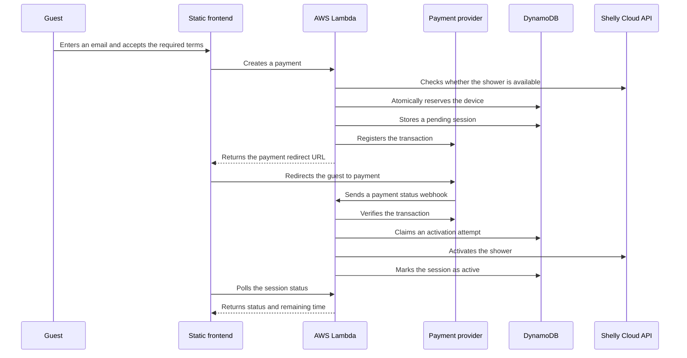

# Port Shower Payment System

[](../../actions/workflows/quality.yml)

An AWS-based system that allows marina guests to pay for and activate a timed shower without staff assistance. The application connects an online payment flow with a physical Shelly-controlled device.

## Why I built it

The project solves a real operational problem at a marina: giving guests immediate, self-service access to a paid shower while keeping the process simple for both customers and staff.

After a successful payment, the backend verifies the transaction, stores its state in DynamoDB, activates the shower through the Shelly Cloud API, and exposes the remaining session time to the frontend.

This repository is a sanitized portfolio version of a system used in production. Company branding, legal documents, production endpoints, device identifiers, and credentials have intentionally been removed.

## How it works



## Key components

### AWS Lambda — serverless backend

The Python backend runs as an AWS Lambda function exposed through a Lambda
Function URL. It handles payment creation, payment-provider webhooks, and
frontend status requests. Lambda keeps the service operational without a
continuously running server and scales request handling automatically.

The entry point is intentionally small. HTTP routing, business rules, and
external integrations are separated into dedicated modules so they can be
tested without an AWS environment.

### Amazon S3 — static frontend hosting

The customer-facing application is built with HTML, CSS, and vanilla
JavaScript and is hosted as an Amazon S3 static website. The frontend collects
the customer's email address, starts the payment flow, polls the backend for
the session status, and displays the remaining shower time.

This architecture keeps presentation assets independent from the Lambda
backend. The S3 bucket contains only public files and public configuration;
credentials remain in the Lambda environment.

### Amazon DynamoDB — session state and concurrency control

DynamoDB stores payment sessions and the current reservation of the physical
device. Conditional writes provide an atomic reservation mechanism, preventing
two customers from purchasing access to the same shower at the same time.

The stored state also makes webhook processing idempotent, supports retryable
activation attempts, and uses TTL values to remove temporary records
automatically.

### Shelly Cloud API — IoT device integration

The shower is controlled by a Shelly smart relay connected through the Shelly
Cloud API. Before registering a payment, the backend checks that the device is
online and that its output is not already active. After a verified payment,
Lambda sends the command that switches the relay on.

Device identifiers and authentication keys are supplied through environment
variables and are not included in the frontend or repository.

### Przelewy24 API — payment gateway

Przelewy24 handles the online payment flow. The backend creates a transaction
and returns the provider's redirect URL to the frontend. Przelewy24 then sends
an asynchronous webhook to Lambda, where the transaction amount and session
are checked before the payment is verified with the provider.

Registration and verification requests are authenticated with API credentials
and SHA-384 signatures. Shower activation happens only after successful
server-to-server verification; returning to the frontend alone is not treated
as proof of payment.

## Main features

- Online payment registration and verification
- Serverless request handling with AWS Lambda
- Payment-session state stored in DynamoDB
- Physical shower activation through the Shelly Cloud API
- Duplicate-webhook protection using a conditional DynamoDB update
- Atomic device reservation with automatic expiry
- Retryable activation workflow with explicit session states
- Device availability check before payment registration
- Responsive static frontend with payment and countdown views
- Configuration and credentials supplied through environment variables

## Technology

- Python
- AWS Lambda Function URL
- Amazon DynamoDB
- Amazon S3 static website hosting
- Przelewy24 payment API
- Shelly Cloud API
- HTML, CSS, and vanilla JavaScript
- Python `unittest`

## Repository structure

```text
.
├── backend/
│   ├── lambda_function.py       # Thin AWS Lambda entry point
│   └── shower_service/
│       ├── handler.py           # HTTP routing and responses
│       ├── service.py           # Application workflow
│       ├── payments.py          # Przelewy24 client and signatures
│       ├── shelly.py            # Shelly Cloud client
│       ├── repository.py        # DynamoDB session persistence
│       └── config.py            # Environment-based configuration
├── frontend/
│   ├── index.html               # Payment form
│   ├── waiting.html             # Payment confirmation view
│   ├── success.html             # Active-session countdown
│   ├── error.html               # Payment error view
│   ├── config.js                # Public frontend configuration
│   └── *.js / styles.css
├── tests/
│   ├── test_api_handler.py      # HTTP contract tests
│   ├── test_shower_service.py   # Business workflow tests
│   └── test_integrations.py     # Payment signatures and Shelly behavior
└── .env.example                 # Required backend configuration
```

## Configuration

The backend expects the following environment variables:

| Variable | Purpose |
| --- | --- |
| `SHELLY_AUTH_KEY` | Shelly Cloud API credential |
| `DEVICE_ID` | Identifier of the controlled Shelly device |
| `P24_MERCHANT_ID` | Przelewy24 merchant identifier |
| `P24_POS_ID` | Przelewy24 point-of-sale identifier |
| `P24_API_KEY` | Przelewy24 API credential |
| `P24_CRC` | Secret used to sign Przelewy24 requests |
| `BASE_URL` | Przelewy24 API base URL |
| `PRICE` | Transaction amount in the smallest currency unit |
| `DYNAMODB_TABLE` | DynamoDB session-table name |
| `FRONTEND_BASE_URL` | Public URL of the static frontend |
| `PUBLIC_API_BASE_URL` | Public URL of the Lambda API |
| `SHOWER_DURATION_SECONDS` | Duration of an activated shower session |
| `SESSION_TTL_SECONDS` | Retention period for pending sessions |
| `PAYMENT_RESERVATION_SECONDS` | Time reserved for completing a payment |
| `ACTIVATION_LEASE_SECONDS` | Lease used to recover interrupted activation attempts |

Copy `.env.example` when preparing a local or test environment. Never commit the populated environment file.

The frontend API address is configured in `frontend/config.js`:

```javascript
window.APP_CONFIG = {
    apiBaseUrl: "https://your-api.example.com",
    pricePln: "15.00",
    showerDurationSeconds: 360
};
```

Only a public endpoint belongs in this file. Backend credentials must remain in the Lambda environment or an AWS secret-management service.

## Running the checks

The backend supports Python 3.11 and newer. Install the local development tools:

```bash
python3 -m pip install -e ".[dev]"
```

Run formatting verification, linting, type checks, tests, and JavaScript syntax checks with one command:

```bash
./check
```

The test suite does not contact AWS, Przelewy24, or Shelly. To run only the tests:

```bash
python3 -m unittest discover -s tests -v
```

To preview the frontend locally:

```bash
python3 -m http.server 8000 --directory frontend
```

Then open `http://localhost:8000` in a browser. Payment creation requires a separately deployed API configured in `frontend/config.js`.

## Security and privacy

- Credentials are read from environment variables and are not stored in the repository.
- Customer email addresses are sent in the request body instead of the URL.
- Customer email addresses and complete payment webhooks are not written to application logs.
- The portfolio copy contains no production API endpoints, company data, device identifiers, credentials, or legal documents. The public production frontend is linked intentionally.
- DynamoDB records use TTL values so temporary session data can expire automatically.

## Known limitations and future work

- Add infrastructure as code for Lambda, DynamoDB, S3, IAM, monitoring, and deployment configuration.
- Expand automated coverage for webhook verification, DynamoDB failures, device failures, and concurrent requests.
- Add rate limiting and abuse protection in front of the public API.

These limitations reflect deliberate trade-offs for the current usage scale and are documented here to make the system's operational boundaries explicit.

## Project status

The production system is operational. This repository is a cleaned and anonymized portfolio copy intended to demonstrate the architecture and implementation without exposing production configuration.
